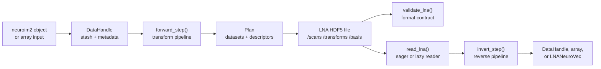

# neuroarchive

<!-- badges: start -->
[](https://github.com/bbuchsbaum/neuroarchive/actions/workflows/R-CMD-check.yaml)
[](https://github.com/bbuchsbaum/neuroarchive)
<!-- badges: end -->

`neuroarchive` reads, writes, validates, and lazily accesses Latent
NeuroArchive (LNA) files: HDF5 archives for transform-aware compression
of neuroimaging data. An LNA file stores compressed payloads together
with the transform descriptors, spatial metadata, and reconstruction
contract needed to inspect or rebuild the data later.

The package is designed for fMRI workflows where data are large,
spatially structured, and repeatedly transformed. The preferred input
currency is a spatially aware `neuroim2` object such as
`DenseNeuroVec`, `SparseNeuroVec`, `DenseNeuroVol`, or
`SparseNeuroVol`, because those classes retain spacing, origin, masks,
and related metadata. Bare arrays remain supported as a low-level
fallback.

The stable core is:

- `write_lna()`: write a validated transform pipeline to HDF5;
- `read_lna()`: reconstruct eagerly or return a lazy reader;
- `validate_lna()`: check the LNA file contract;
- `LNANeuroVec()`: expose an archive as a lazy `neuroim2`-compatible
  object;
- an experimental BIDS-shaped exchange profile for packaging, querying,
  transferring, updating, and restoring multi-subject fMRI datasets.

Experimental transforms and low-level performance utilities are also
included, but the core archive contract is the part to build on first.

The pointwise parcel-series profile is available through
`lna_profile_analysis_safe()`, currently with an **experimental** lifecycle.
It preserves every parcel--TR value up to a fixed pointwise quantization bound,
then predicts and packs the integers reversibly. The profile name describes
its leakage support when parcel labels, weights, quantizer steps, and
normalization are fixed or calibrated on disjoint external data; it is not yet
a stable scientific endorsement. The machine split vocabulary calls this
`pointwise` (individual TR observations may be assigned independently). See
[`vignettes/analysis_safe_qpp.Rmd`](vignettes/analysis_safe_qpp.Rmd) for the
reader-first workflow and
[`inst/spec/qpp-release-checklist-v1.md`](inst/spec/qpp-release-checklist-v1.md)
for the gate decision.

### Architecture



If you pass a bare array to `write_lna()`, keep the time dimension last
(for example `dim = c(nx, ny, nz, nt)` for a 4D volume). Before a
transform runs, arrays are reshaped into a matrix with rows
corresponding to time points and columns corresponding to voxels.

```r
library(neuroarchive)
library(neuroim2)

# Example data with spatial metadata
sp <- NeuroSpace(c(4L, 4L, 4L), spacing = c(2, 2, 2))
mask <- LogicalNeuroVol(array(TRUE, dim = c(4L, 4L, 4L)), sp)
mask_vol <- NeuroVol(as.integer(as.array(mask)), sp)
sim <- simulate_fmri(mask_vol, n_time = 1L, seed = 42L)
x <- methods::as(sim, "DenseNeuroVec")

# Write data with the quant transform
res <- write_lna(x,
                 file = "example.lna.h5",
                 transforms = "quant")

# Validate the file
validate_lna("example.lna.h5")

# Lazy reading using lna_reader
r <- read_lna("example.lna.h5", lazy = TRUE)
str(r$data())
r$close()
```

### Recommended Pipelines

Start with the smallest pipeline that matches the scientific tolerance
for loss and reconstruction cost.

| Pipeline | Use case | Notes |
| --- | --- | --- |
| `parcel.mean -> qpp` | Pointwise parcel time-series storage | Experimental named profile; exact integer prediction and arbitrary TR splits only with fixed or disjoint-external fitted assets. |
| `quant` | Baseline lossy compression | Simple, fast, and a good first comparison point. |
| `basis -> embed -> quant` | Latent PCA-style compression | Stores coefficients rather than dense voxel data. |
| `embed.shared_basis -> quant` | Group studies with a shared spatial basis | Stores per-subject coefficients while the basis is deduplicated. |
| `spat.hrbf`, `spat.haar_octwave` | Spatial experimental compression | Promising but should be treated as more specialized. |

The proposed `multiresolution-run` wavelet mode is deliberately unavailable.
Its reproducible prototype did not meet the predeclared rate and untouched
GLM-t gates, so `lna_profile_multiresolution_run()` returns a no-go status
object rather than production write arguments. Assets produced by `fmrilatent`
are not intrinsically unsafe: their compatibility depends on fit scope and
lossy temporal support, not package identity.

### PCA Compression Pipeline

```r
# Compress with basis -> embed -> quant
pca_file <- "pca_example.h5"
write_lna(
  x,
  pca_file,
  transforms = c("basis", "embed", "quant"),
  transform_params = list(basis = list(k = 5))
)

# Select coefficients using run_id globbing and read lazily
r2 <- read_lna(pca_file, run_id = "run-*", lazy = TRUE)
r2$subset(roi_mask = mask, time_idx = 1:2)
str(r2$data())
r2$close()
```

`read_lna()` supports glob patterns in `run_id` for selecting
multiple runs, and both `roi_mask` and `time_idx` can be specified at
read time or via the lazy reader.

For multiple runs from one subject, pass a named list. Each run is transformed
independently and stored under its own `/scans/run-XX` boundary:

```r
runs <- setNames(
  list(run1, run2, run3, run4, run5, run6),
  sprintf("run-%02d", 1:6)
)
write_lna(runs, "sub-01_task-rest.lna.h5", transforms = "quant")

# Eager wildcard reads return a named list of six DataHandles.
decoded <- read_lna("sub-01_task-rest.lna.h5", run_id = "run-*", lazy = FALSE)

# Lazy wildcard reads return a named list of independent readers.
lazy_runs <- read_lna(
  "sub-01_task-rest.lna.h5", run_id = "run-*", lazy = TRUE
)
run3 <- lazy_runs[["run-03"]]
lapply(lazy_runs, function(reader) reader$close())
```

Use `aggregate_runs` as the first transform only when intentionally combining
runs; ordinary pipelines never fit parameters or predictors across a run
boundary.

### BIDS-Shaped fMRI Exchange Datasets

The experimental dataset profile maps one source image to one `.lna.h5`
artifact and records exact BIDS entities, resolved metadata, associations,
source checksums, full affine geometry, and provenance-asserted reference
identity in a typed manifest. Raw native images remain distinct by default;
MNI-normalized images can share resources only when grid, support, and asserted
reference identity all match.

The core works from neuroarchive-owned `lna_source_record` values and does not
require bidser. `lna_source_records_from_bidser()` is an optional discovery
adapter requiring bidser 0.5.1 or later. Packaging, exact manifest queries,
closed or explicitly partial restoration, previewed transactional updates, and
checksummed resumable transfer remain neuroarchive responsibilities.

See [`vignettes/bids_datasets.Rmd`](vignettes/bids_datasets.Rmd) for the
complete workflow and [`inst/spec/bids-fmri-profile-v1.md`](inst/spec/bids-fmri-profile-v1.md)
for the field, ownership, failure, and maturity contract. `.lna.h5` is a
neuroarchive extension in a BIDS-shaped envelope; it is not a recognized BIDS
imaging extension.

### Parameter Merging

`transform_params` are resolved in the following order:

1. defaults from each transform's JSON schema via
   `default_params()`;
2. package level options set with `lna_options()`;
3. parameters supplied in the `transform_params` argument.

Later sources override earlier ones using a deep merge.

`write_lna()` also accepts a `block_table` data frame describing spatial
blocks to store under `/spatial/block_table` and an optional `plugins`
list saved in `/plugins`.

### Validation Contract

`validate_lna()` is the trust boundary for LNA files written by this
package. The LNA v2 validation contract defines required root
attributes, required HDF5 groups, transform descriptor rules, dataset
reference checks, and checksum behavior. See
[`inst/spec/lna-v2-validation.md`](inst/spec/lna-v2-validation.md) for
the current contract.

### Parallel Writing

`write_lna()` opens files using HDF5 mode `"w"`, which truncates the
target path if it already exists.  When writing in parallel each writer
should therefore create a unique temporary file and use
`file.rename()` to atomically move it into place after a successful
write.  This avoids collisions between concurrent writers.

See `vignettes/cookbook.Rmd` for additional examples including ROI/time
slicing with the lazy reader and scaffolding new transforms.

### Extending Temporal Basis Types

Packages can provide additional temporal basis kinds by defining functions of
the form `temporal_basis.<kind>()`. These methods should return a matrix with
`n_time` rows and `n_basis` columns. The generic `temporal_basis()` is used by
the core `temporal` transform and will dispatch to these user-defined methods
when `kind` matches `<kind>`.

### Running Unit Tests

Unit tests require an R installation. Use the `run-tests.sh` helper script to
execute them from the project root. If `R` is unavailable, the script will
gracefully skip the tests.

<!-- albersdown:theme-note:start -->
## Albers theme
This package uses the albersdown theme. Existing vignette theme hooks are replaced so `albers.css` and local `albers.js` render consistently on CRAN and GitHub Pages. The defaults are configured via `params$family` and `params$preset` (family = 'red', preset = 'homage'). The pkgdown site uses `template: { package: albersdown }`.
<!-- albersdown:theme-note:end -->
